# Cad3DApp
## 三面図からつくる三次元ＣＡＤ

平面図や側面図で作成した図形から3D図形を作成する三次元CAD  
当初、サーフェースのグラフィックライブラリを自作して作っていたが描画速度や機能的に限界があったので OpenGL を使って作成。  
使い方などは[説明書](Document/Cad3DApp_Manual.pdf)を参照。  
Mini3DCadのソースを見直して再作成したもので機能的にはMini3DCadとほとんど同じ

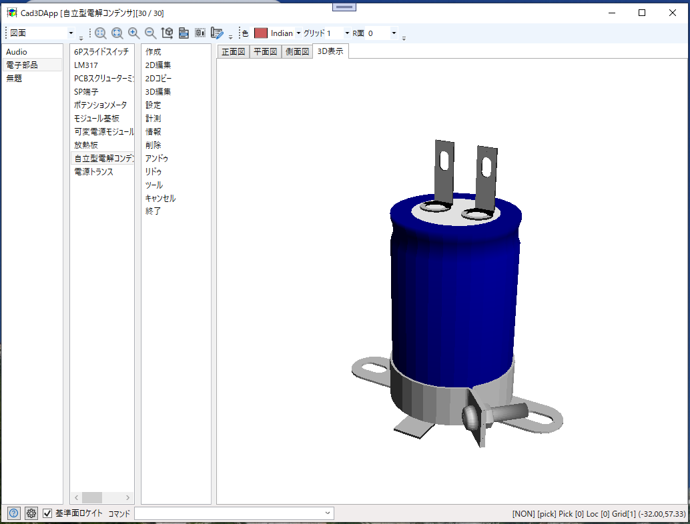

### 画面
2D表示    
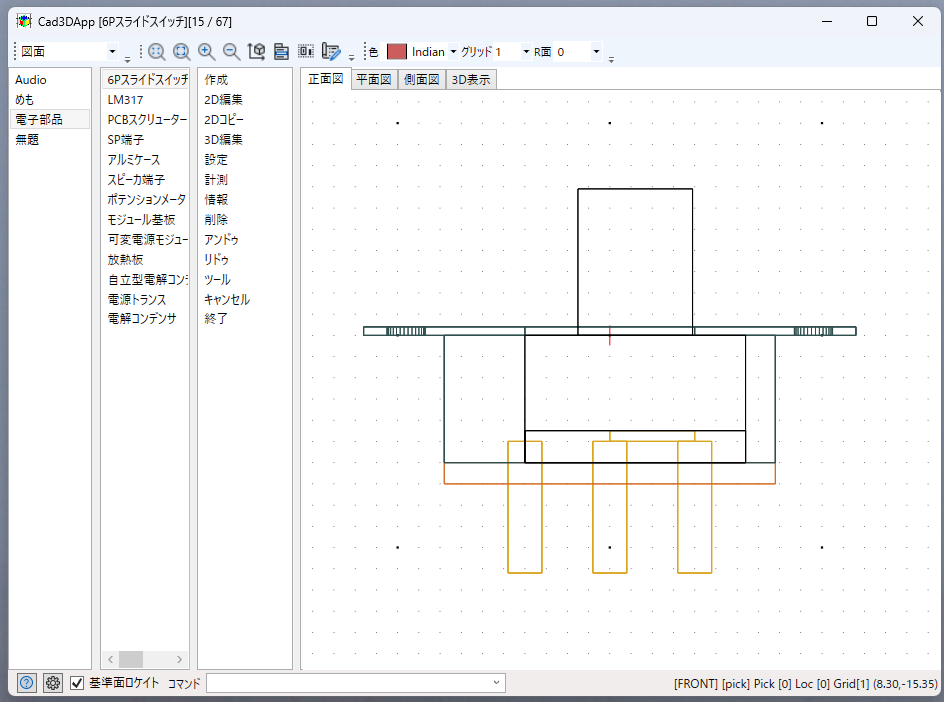  

3D表示  
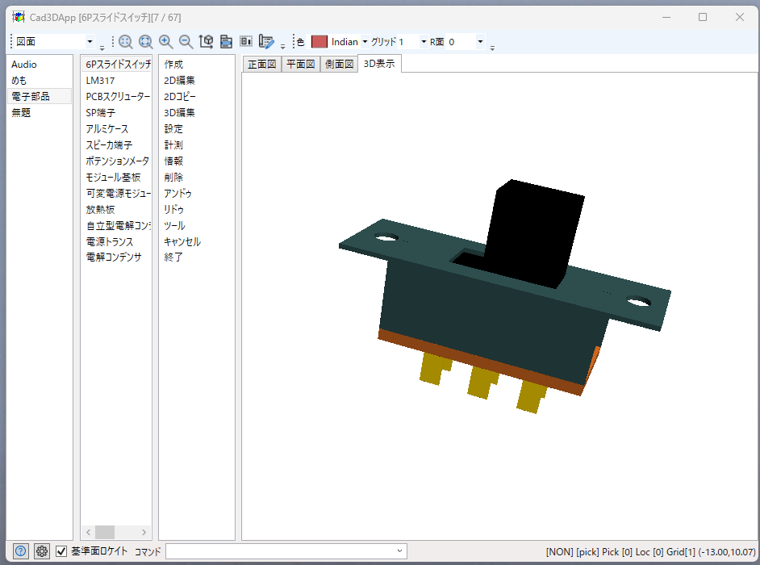  

2Dデータから3Dデータの作成(押出)  
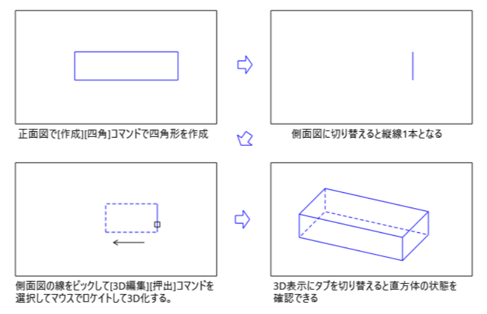  

スピーカ端子(2D)　　
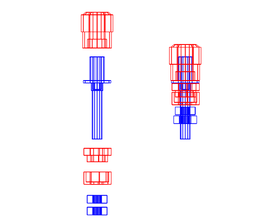  
スピーカ端子(3D)　　
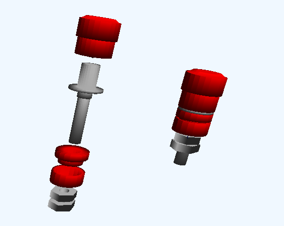  

ティーカップ(2D)　　
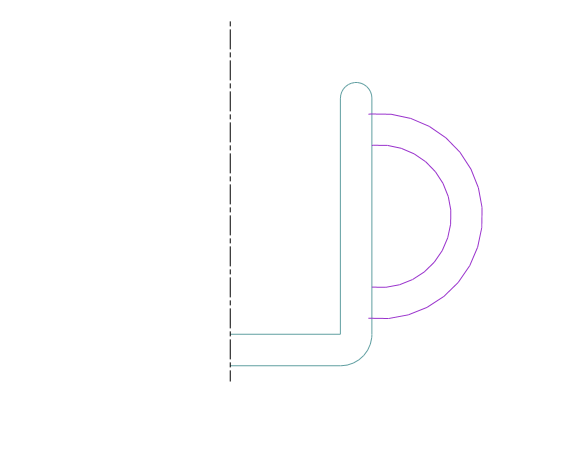  

ティーカップ(3D化)　　
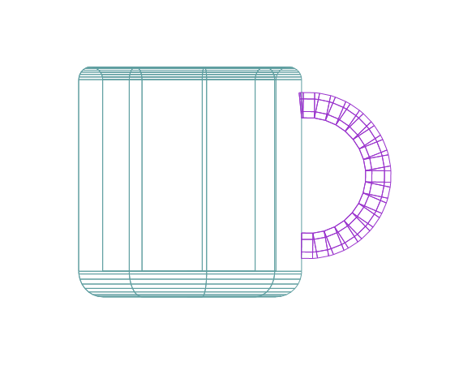  

ティーカップ(3D)　　
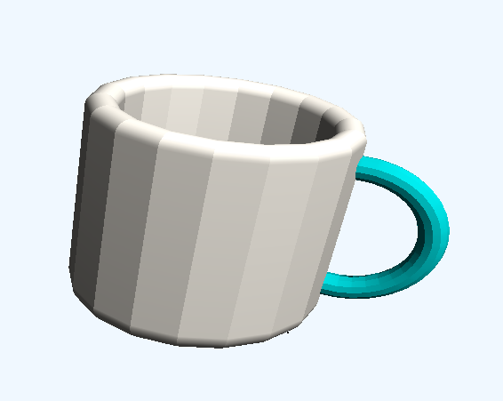  

スピーカ(正面図、側面図)  
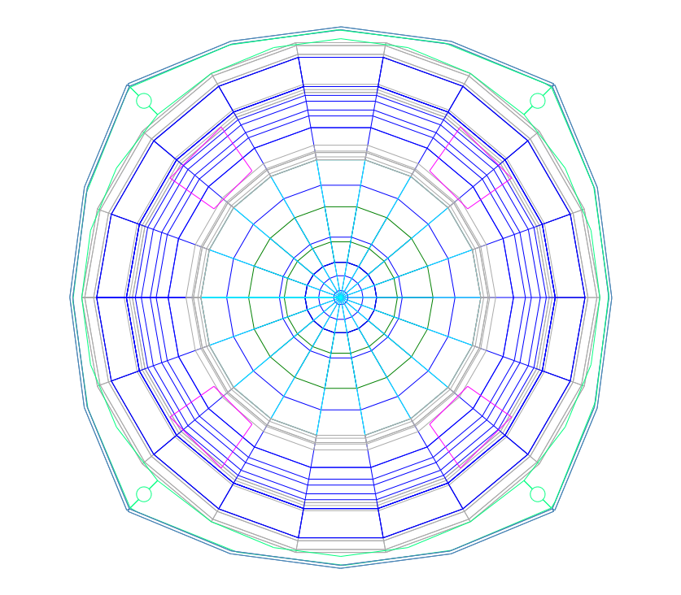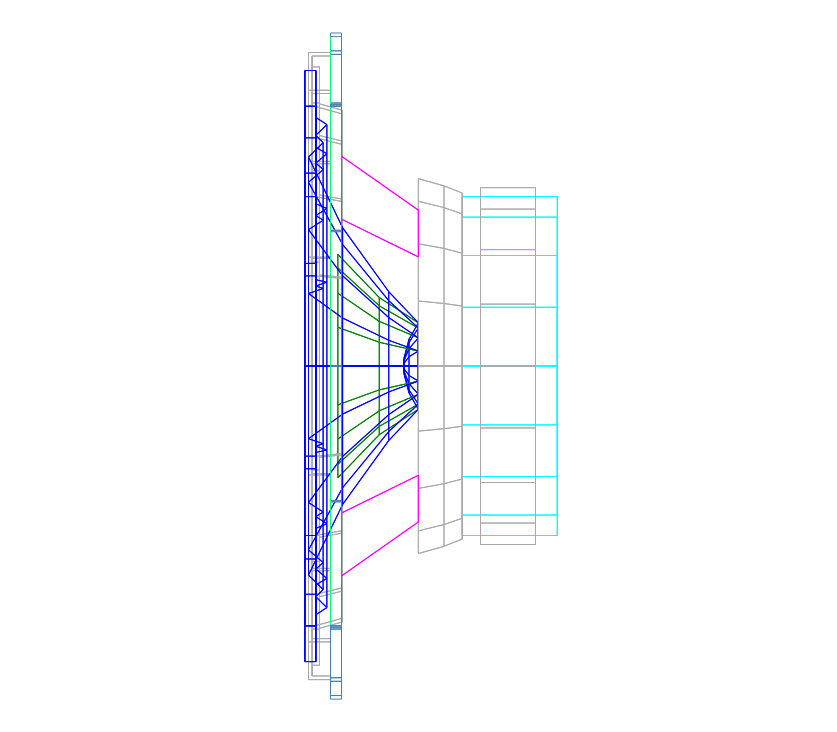  

スピーカ(3D)
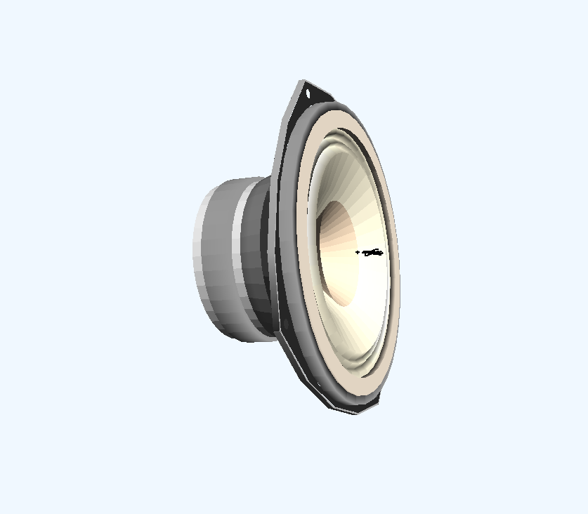  

バックロードホーン(2D)  
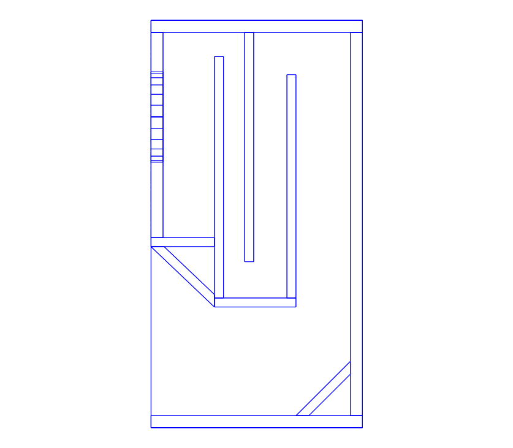  
バックロードホーン(3D)  
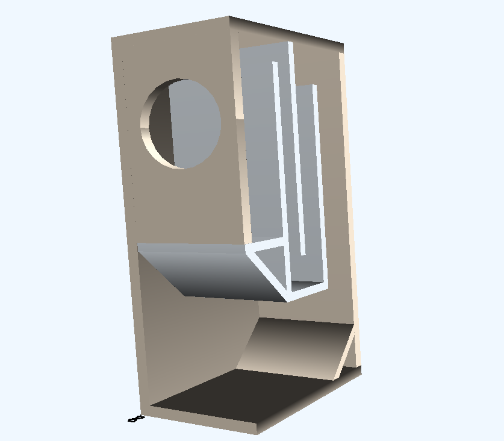  

電解コンデンサ(3D)  
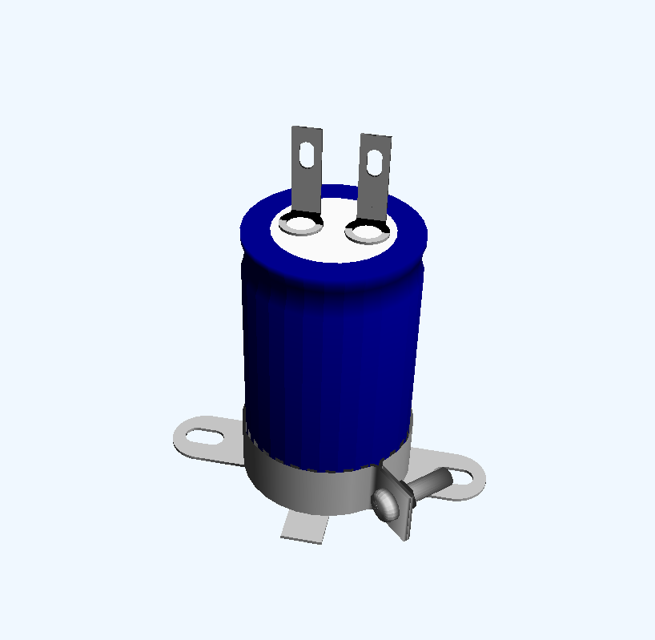  

電源トランス(3D)  
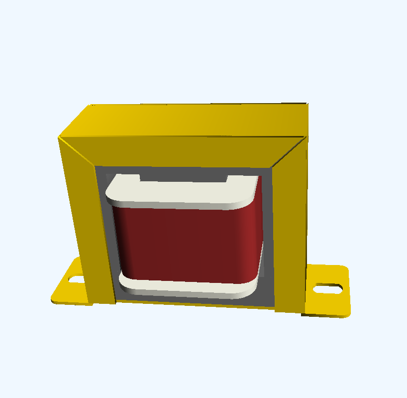  

### 履歴
2026/09/09 ポリラインのdivideバグ修正(Polyline3D)、回転体の中心線を残す
2025/07/09 実験的にスクリプト機能を追加  
2025/06/01 キーコマンドを追加  
2025/05/05 2D非表示機能追加  
2025/04/24 GitHubに登録  
2025/04/18 リドゥを追加(CommandOpe.undo(),redo(),EditEntity.addEntity())  
2025/04/08 ワイヤーフレーム表示追加(2DVertexListから変換)  
2025/03/?? ブレンド機能追加(複数要素対応)  
2025/02/?? 押出で複数要素から中抜きを一括一括作成(水平スキャン方式)  
2025/01/?? Mini3DCadから移植し直し(Primitive → Entity)  

### ■実行環境
[Cad3DApp.zip](Cad3DApp.zip)をダウンロードして適当なフォルダに展開し、フォルダ内の Mini3DCad.exe をダブルクリックして実行します。  
動作環境によって「.NET 8.0 Runtime」が必要になる場合もあります。  
https://dotnet.microsoft.com/ja-jp/download

### ■開発環境  
開発ソフト : Microsoft Visual Studio 2022  
開発言語　 : C# 10.0 Windows アプリケーション  
フレームワーク　 :  .NET 8.0  
NuGetライブラリ : なし  
自作ライブラリ  : CoreLib (三次元の幾何計算も含む)  
